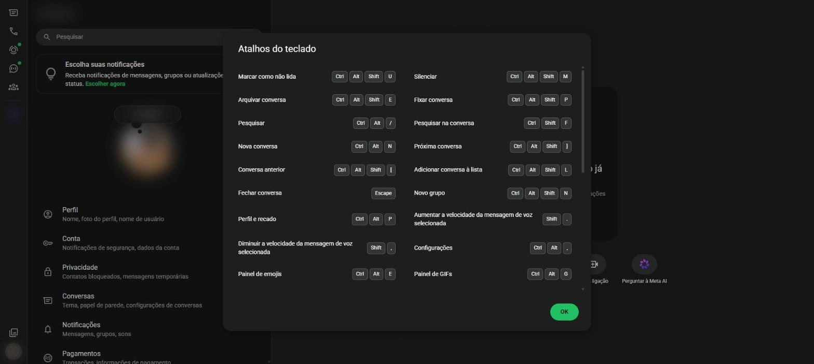

# Atalhos do teclado {#sec-atalhos}

No WhatsApp Web, várias ações podem ser feitas pelo teclado. A lista completa aparece em **Configurações** > **Atalhos do teclado** (@fig-atalhos).

{#fig-atalhos}

| Ação | Atalho |
|---|---|
| Nova conversa | <kbd>Ctrl</kbd> + <kbd>Alt</kbd> + <kbd>N</kbd> |
| Novo grupo | <kbd>Ctrl</kbd> + <kbd>Alt</kbd> + <kbd>Shift</kbd> + <kbd>N</kbd> |
| Pesquisar | <kbd>Ctrl</kbd> + <kbd>Alt</kbd> + <kbd>/</kbd> |
| Pesquisar na conversa | <kbd>Ctrl</kbd> + <kbd>Shift</kbd> + <kbd>F</kbd> |
| Próxima conversa | <kbd>Ctrl</kbd> + <kbd>Alt</kbd> + <kbd>Shift</kbd> + <kbd>]</kbd> |
| Conversa anterior | <kbd>Ctrl</kbd> + <kbd>Alt</kbd> + <kbd>Shift</kbd> + <kbd>[</kbd> |
| Fechar conversa | <kbd>Esc</kbd> |
| Marcar como não lida | <kbd>Ctrl</kbd> + <kbd>Alt</kbd> + <kbd>Shift</kbd> + <kbd>U</kbd> |
| Silenciar | <kbd>Ctrl</kbd> + <kbd>Alt</kbd> + <kbd>Shift</kbd> + <kbd>M</kbd> |
| Arquivar conversa | <kbd>Ctrl</kbd> + <kbd>Alt</kbd> + <kbd>Shift</kbd> + <kbd>E</kbd> |
| Fixar conversa | <kbd>Ctrl</kbd> + <kbd>Alt</kbd> + <kbd>Shift</kbd> + <kbd>P</kbd> |
| Adicionar conversa à lista | <kbd>Ctrl</kbd> + <kbd>Alt</kbd> + <kbd>Shift</kbd> + <kbd>L</kbd> |
| Perfil e recado | <kbd>Ctrl</kbd> + <kbd>Alt</kbd> + <kbd>P</kbd> |
| Configurações | <kbd>Ctrl</kbd> + <kbd>Alt</kbd> + <kbd>,</kbd> |
| Painel de emojis | <kbd>Ctrl</kbd> + <kbd>Alt</kbd> + <kbd>E</kbd> |
| Painel de GIFs | <kbd>Ctrl</kbd> + <kbd>Alt</kbd> + <kbd>G</kbd> |
| Aumentar a velocidade do áudio selecionado | <kbd>Shift</kbd> + <kbd>.</kbd> |
| Diminuir a velocidade do áudio selecionado | <kbd>Shift</kbd> + <kbd>,</kbd> |
| Pular linha sem enviar | <kbd>Shift</kbd> + <kbd>Enter</kbd> |

: Atalhos do WhatsApp Web no Windows {.striped}

No Mac, troque <kbd>Ctrl</kbd> por <kbd>Cmd</kbd> e <kbd>Alt</kbd> por <kbd>Option</kbd>.
