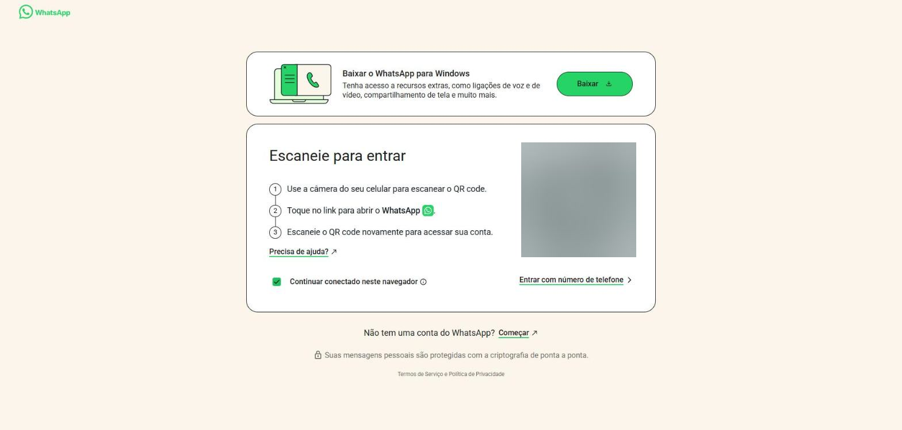

# Conhecendo o WhatsApp {#sec-conhecendo}

O WhatsApp é um aplicativo gratuito de mensagens que funciona pela internet. Com ele você troca mensagens de texto, áudios, fotos, vídeos e documentos, faz ligações de voz e vídeo e participa de grupos, sem pagar por mensagem enviada. O nome é um trocadilho com a expressão inglesa *What's up?*, algo como "E aí?" [@guiaifb2026].

A conta do WhatsApp fica ligada a um número de celular. O celular é o aparelho principal; o computador, o tablet e outros aparelhos são conectados a essa mesma conta.

## Onde o WhatsApp funciona

| Versão | Onde usar | Como entrar |
|---|---|---|
| Aplicativo para celular | Android e iPhone | Instalado pela loja de aplicativos, com o número de telefone |
| WhatsApp Web | Qualquer navegador no computador | Endereço `web.whatsapp.com`, lendo um QR code com o celular |
| Aplicativo para computador | Windows e Mac | Instalado pela Microsoft Store ou pela App Store, conectado pelo celular |

: Versões do WhatsApp {.striped}

As funções são praticamente as mesmas em todas as versões. Algumas configurações da conta, como a verificação em duas etapas e as cópias de segurança, só existem no celular.

## Principais funções

- Enviar e receber mensagens de texto, com emojis, GIFs e figurinhas;
- Gravar e enviar mensagens de voz;
- Enviar fotos, vídeos, documentos, contatos, enquetes e eventos;
- Fazer ligações de voz e de vídeo, individuais ou em grupo;
- Criar e participar de grupos e comunidades;
- Seguir canais de notícias, órgãos públicos e personalidades;
- Publicar status com fotos, vídeos e textos que somem em 24 horas;
- Proteger a conta e controlar quem vê suas informações.

## Instalar o WhatsApp no celular

1. Descubra o sistema do seu celular. A maioria dos aparelhos usa **Android**; os aparelhos da Apple usam **iOS** (iPhone).
2. Abra a loja de aplicativos: **Play Store** no Android ou **App Store** no iPhone.
3. Toque na barra de pesquisa, na parte de cima da tela, e escreva `WhatsApp`.
4. Escolha o aplicativo **WhatsApp Messenger**, publicado pela WhatsApp LLC, e toque em **Instalar** (ou **Obter**, no iPhone).
5. Quando a instalação terminar, toque em **Abrir**.
6. Aceite os termos, informe o número do seu celular e digite o código de 6 números que chega por SMS.
7. Escreva seu nome e, se quiser, escolha uma foto de perfil.

::: {.callout-warning}
## Cuidado com o código de verificação

O código de 6 números que chega por SMS serve só para você. Nunca o repasse a ninguém, nem a quem diga ser do WhatsApp, do banco ou de uma loja. Quem tem esse código consegue entrar na sua conta.
:::

## Entrar no WhatsApp Web

O WhatsApp Web mostra as suas conversas na tela grande do computador, com teclado e mouse, o que facilita escrever mensagens longas e enviar arquivos.

1. No computador, abra o navegador e acesse `web.whatsapp.com`. Aparece a tela da @fig-login, com um QR code à direita.
2. No celular, abra o WhatsApp.
   - **Android**: toque nos três pontinhos, no canto de cima, e depois em **Aparelhos conectados**.
   - **iPhone**: toque em **Configurações** e depois em **Aparelhos conectados**.
3. Toque em **Conectar um aparelho** e, se pedido, confirme com a digital, o rosto ou a senha do celular.
4. Aponte a câmera do celular para o QR code que aparece no computador.
5. Aguarde alguns segundos. As conversas carregam na tela do computador.

{#fig-login}

A opção **Continuar conectado neste navegador** mantém o acesso mesmo depois de fechar o navegador. Em computadores de uso coletivo, como os de escolas, bibliotecas e lan houses, desmarque essa opção.

Também é possível entrar sem câmera: clique em **Entrar com número de telefone**, informe o número e digite no celular o código que aparece no computador.

::: {.callout-tip}
## Celular desligado

Depois de conectado, o WhatsApp Web continua funcionando mesmo com o celular sem internet ou desligado. Se o celular ficar 14 dias sem uso, os aparelhos conectados são desconectados automaticamente.
:::

## Sair do WhatsApp Web

Sair é importante quando o computador não é seu.

- **Pelo computador**: clique nos três pontinhos acima da lista de conversas e escolha **Desconectar** (@fig-menu-principal, no próximo capítulo).
- **Pelo celular**: abra **Aparelhos conectados**, toque no aparelho da lista e depois em **Desconectar**. Esse caminho funciona mesmo longe do computador.
