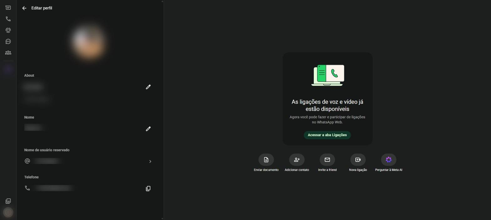

# Perfil {#sec-perfil}

O perfil reúne as informações que os seus contatos veem sobre você: foto, nome e recado.

## Abrir o perfil

1. Clique na sua foto, no canto de baixo da barra lateral (ícone **Você**). Abre a tela de configurações (@fig-configuracoes, no @sec-configuracoes).
2. Clique em **Perfil**. Aparece a tela **Editar perfil** (@fig-perfil).

No celular, o caminho é três pontinhos > **Configurações** e depois toque na sua foto (Android) ou **Configurações** > sua foto (iPhone).

{#fig-perfil}

## Trocar a foto de perfil

1. Na tela **Editar perfil**, clique na sua foto.
2. Escolha uma das opções:
   - **Tirar foto**: usa a câmera do computador;
   - **Carregar foto**: escolhe uma imagem guardada no computador;
   - **Remover foto**: apaga a foto atual.
3. Ajuste o enquadramento arrastando e usando o zoom e clique no botão de confirmação.

## Alterar o recado

O **recado** (chamado de *About* em algumas versões) é uma frase curta que aparece no seu perfil, como "Disponível" ou "No trabalho".

1. Clique no lápis ao lado do recado atual.
2. Apague o texto, escreva o novo recado e pressione <kbd>Enter</kbd>.

## Alterar o nome

O nome aparece para quem não tem o seu número salvo na agenda e nas notificações de quem recebe suas mensagens.

1. Clique no lápis ao lado de **Nome**.
2. Escreva o novo nome e pressione <kbd>Enter</kbd>.

## Nome de usuário e telefone

- **Nome de usuário reservado**: um apelido único, começando com `@`, que permite que outras pessoas encontrem você sem saber o seu número.
- **Telefone**: o número ligado à conta. O botão ao lado copia o número. Ele não pode ser trocado por aqui; a troca de número é feita no celular, em **Configurações** > **Conta** > **Mudar número**.

::: {.callout-note}
## Quem vê o quê

Quem pode ver a sua foto, o recado e o horário em que você esteve on-line é definido na tela de privacidade (@sec-privacidade).
:::
