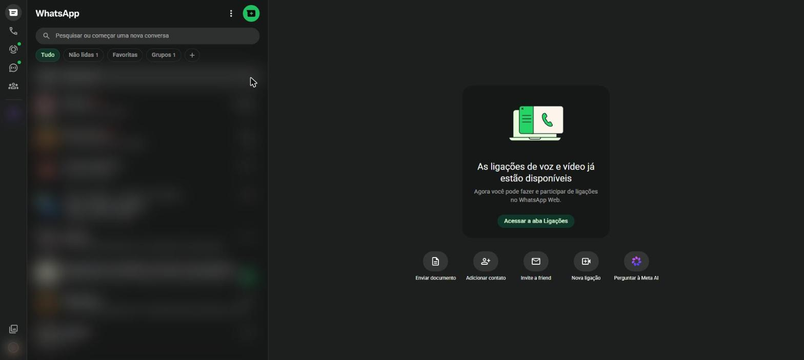
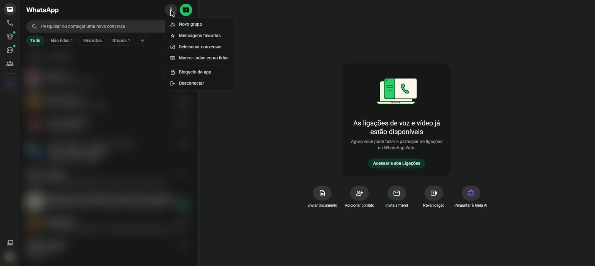

# A tela inicial {#sec-tela-inicial}

Depois de entrar, o WhatsApp Web mostra a tela inicial (@fig-tela-inicial). Ela é dividida em três áreas:

1. **Barra lateral**, à esquerda, com os ícones que levam às seções do aplicativo;
2. **Lista de conversas**, no centro, com todas as conversas e grupos;
3. **Área da conversa**, à direita, que mostra a conversa aberta. Enquanto nenhuma conversa está aberta, ela exibe atalhos como **Enviar documento**, **Adicionar contato** e **Nova ligação**.

{#fig-tela-inicial}

## A barra lateral

Os ícones da barra lateral, de cima para baixo:

| Ícone | Nome | Para que serve |
|---|---|---|
| Balão de conversa | **Conversas** | Volta para a lista de conversas |
| Telefone | **Ligações** | Histórico de chamadas e novas ligações (@sec-ligacoes) |
| Círculo tracejado | **Status** | Fotos, vídeos e textos que somem em 24 horas (@sec-status) |
| Balão com ondas | **Canais** | Canais que você segue (@sec-canais) |
| Três pessoas | **Comunidades** | Comunidades das quais você participa (@sec-comunidades) |
| Círculo colorido | **Meta AI** | Assistente de inteligência artificial do WhatsApp |
| Moldura de fotos | **Mídia** | Fotos, vídeos e documentos trocados nas conversas |
| Sua foto | **Você** | Perfil e configurações (@sec-perfil e @sec-configuracoes) |

: Ícones da barra lateral {.striped}

Uma bolinha verde sobre um ícone indica que há novidades naquela seção.

## A lista de conversas

Cada linha da lista mostra a foto e o nome do contato ou grupo, o começo da última mensagem e o horário. Um número em um círculo verde indica quantas mensagens ainda não foram lidas. As conversas mais recentes ficam no topo.

Acima da lista ficam:

- **Pesquisar ou começar uma nova conversa**: campo para procurar contatos, grupos e palavras em mensagens;
- **Filtros**: botões **Tudo**, **Não lidas**, **Favoritas** e **Grupos**, que mostram só um tipo de conversa;
- **+** (mais): cria listas personalizadas de conversas (@sec-organizar).

### Pesquisar

1. Clique no campo **Pesquisar ou começar uma nova conversa**.
2. Escreva o nome de um contato, de um grupo ou uma palavra que esteja em alguma mensagem.
3. Os resultados aparecem logo abaixo, separados em conversas, contatos e mensagens. Clique em um resultado para abri-lo.

## O menu principal

Os três pontinhos no alto da lista de conversas abrem o menu principal (@fig-menu-principal).

{#fig-menu-principal}

| Opção | O que faz |
|---|---|
| **Novo grupo** | Cria um grupo de conversa (@sec-grupos) |
| **Mensagens favoritas** | Mostra as mensagens que você marcou com estrela |
| **Selecionar conversas** | Permite marcar várias conversas para arquivar, silenciar ou apagar de uma vez |
| **Marcar todas como lidas** | Zera o contador de mensagens não lidas |
| **Bloqueio do app** | Cria uma senha para abrir o WhatsApp Web neste computador |
| **Desconectar** | Sai do WhatsApp Web neste navegador |

: Opções do menu principal {.striped}

O botão verde ao lado dos três pontinhos abre a tela de **Nova conversa** (@sec-nova-conversa).
