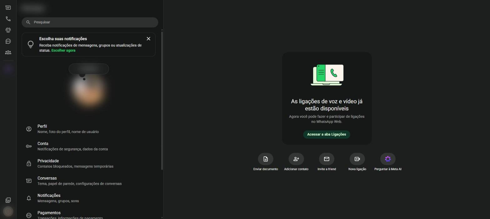
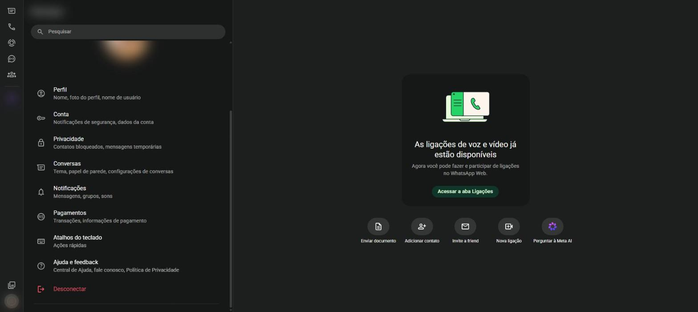
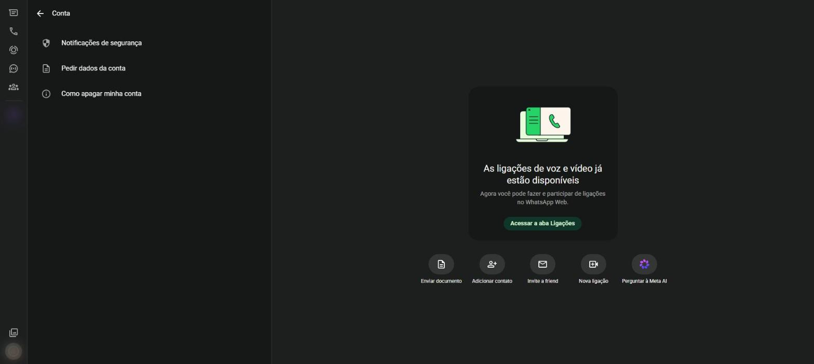
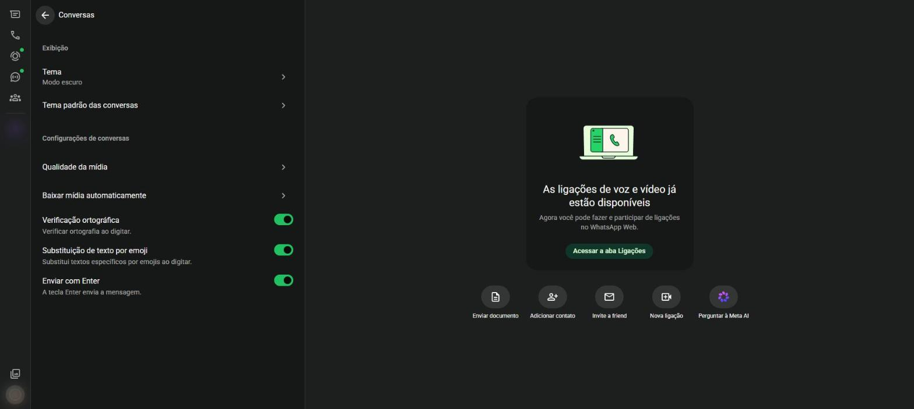
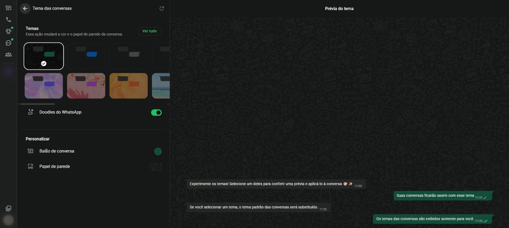
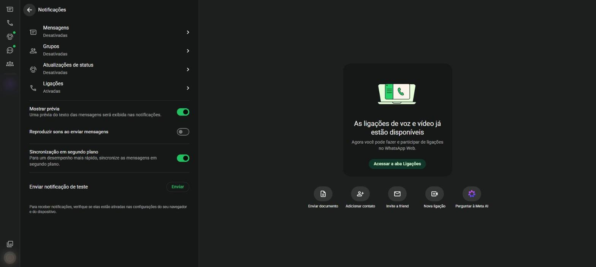

# Configurações {#sec-configuracoes}

As configurações reúnem os ajustes da conta, da aparência, das notificações e da privacidade.

## Abrir as configurações

Clique na sua foto, no canto de baixo da barra lateral (ícone **Você**). Aparece a tela da @fig-configuracoes.

No celular: três pontinhos > **Configurações** (Android) ou a aba **Configurações** (iPhone).

{#fig-configuracoes}

Rolando a tela, aparecem as demais opções (@fig-configuracoes-2).

{#fig-configuracoes-2}

| Opção | O que reúne |
|---|---|
| **Perfil** | Nome, foto, recado e nome de usuário (@sec-perfil) |
| **Conta** | Notificações de segurança e dados da conta |
| **Privacidade** | Quem vê suas informações, bloqueios e mensagens temporárias (@sec-privacidade) |
| **Conversas** | Tema, papel de parede e configurações das conversas |
| **Notificações** | Avisos de mensagens, grupos, status e ligações |
| **Pagamentos** | Transações e informações de pagamento |
| **Atalhos do teclado** | Lista de atalhos do computador (@sec-atalhos) |
| **Ajuda e feedback** | Central de Ajuda, contato com o suporte e Política de Privacidade |
| **Desconectar** | Sai do WhatsApp Web neste navegador |

: Itens das configurações {.striped}

O campo **Pesquisar**, no alto, encontra uma configuração pelo nome.

## Conta

A tela **Conta** (@fig-conta) traz:

- **Notificações de segurança**: avisa quando o código de segurança de um contato muda, o que acontece, por exemplo, quando ele troca de celular;
- **Pedir dados da conta**: gera um relatório com as informações da sua conta;
- **Como apagar minha conta**: explica o passo a passo, que é feito no celular.

{#fig-conta}

## Conversas

A tela **Conversas** (@fig-config-conversas) ajusta a aparência e o comportamento das conversas.

{#fig-config-conversas}

| Opção | O que faz |
|---|---|
| **Tema** | Escolhe entre modo claro, modo escuro ou o padrão do sistema |
| **Tema padrão das conversas** | Escolhe cores e papel de parede para todas as conversas |
| **Qualidade da mídia** | Define se fotos e vídeos são enviados em qualidade padrão ou HD |
| **Baixar mídia automaticamente** | Escolhe quais tipos de arquivo são baixados sem precisar clicar |
| **Verificação ortográfica** | Sublinha palavras escritas errado |
| **Substituição de texto por emoji** | Troca combinações como `:)` pelo emoji correspondente |
| **Enviar com Enter** | Faz a tecla <kbd>Enter</kbd> enviar a mensagem |

: Configurações de conversas {.striped}

### Modo escuro

O modo escuro deixa o fundo preto e as letras claras, o que cansa menos a vista à noite. Em **Conversas** > **Tema**, escolha **Claro**, **Escuro** ou **Padrão do sistema** e clique em **OK**.

### Tema e papel de parede

1. Em **Conversas**, clique em **Tema padrão das conversas** (@fig-tema-conversas).
2. Clique em um dos **Temas** para ver a prévia à direita. **Ver tudo** mostra mais opções.
3. Em **Personalizar**, troque separadamente a cor do **Balão de conversa** e o **Papel de parede**.
4. A chave **Doodles do WhatsApp** liga ou desliga os desenhos discretos do fundo.

{#fig-tema-conversas}

Para mudar o tema de uma única conversa, use **Tema da conversa** no menu daquela conversa (@sec-opcoes-conversa).

### Tamanho da letra

No WhatsApp Web, a letra acompanha o zoom do navegador: <kbd>Ctrl</kbd> + <kbd>+</kbd> aumenta, <kbd>Ctrl</kbd> + <kbd>-</kbd> diminui e <kbd>Ctrl</kbd> + <kbd>0</kbd> volta ao normal.

No celular Android, o caminho é **Configurações** > **Conversas** > **Tamanho da fonte**, com as opções pequena, média e grande. No iPhone, o tamanho segue o ajuste de texto do próprio aparelho. Para quem tem dificuldade de leitura, a letra **grande** é a mais recomendada [@guiaifb2026].

## Notificações

A tela **Notificações** (@fig-notificacoes) controla os avisos que aparecem no computador.

{#fig-notificacoes}

- **Mensagens**, **Grupos**, **Atualizações de status** e **Ligações**: ligam ou desligam os avisos de cada tipo;
- **Mostrar prévia**: exibe o começo da mensagem no aviso;
- **Reproduzir sons ao enviar mensagens**: toca um som a cada envio;
- **Sincronização em segundo plano**: mantém as mensagens atualizadas mesmo com a aba fechada;
- **Enviar notificação de teste**: confere se os avisos estão funcionando.

::: {.callout-note}
## Permissão do navegador

Para receber avisos, o navegador também precisa permitir notificações do site `web.whatsapp.com`. Se aparecer o aviso **As notificações estão desativadas**, clique em **Ativar** e depois em **Permitir**.
:::
