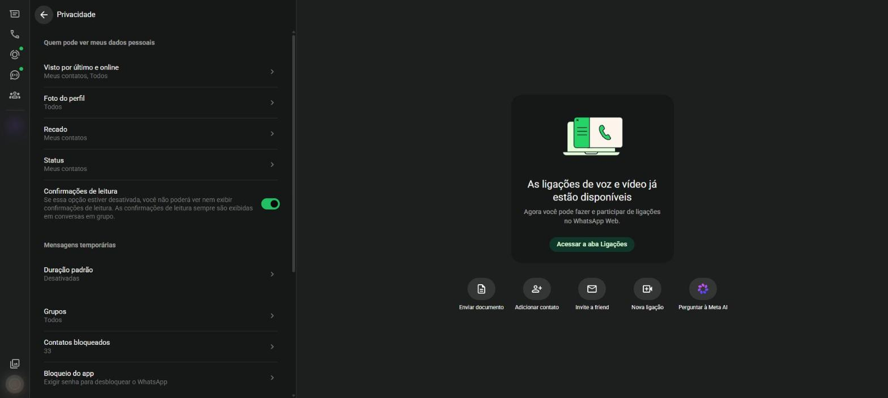
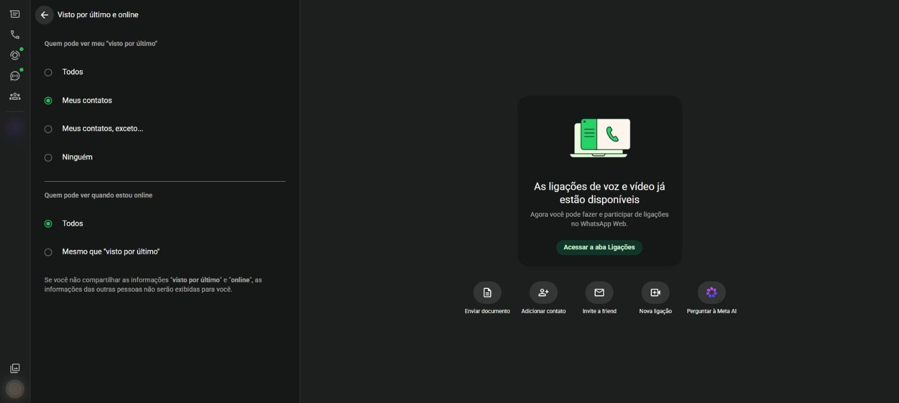
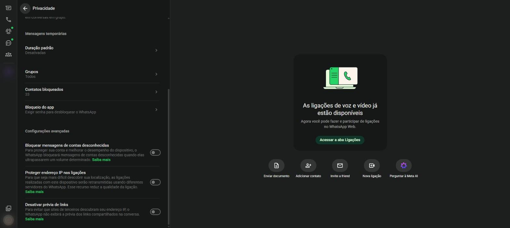

# Privacidade {#sec-privacidade}

Privacidade é o direito de decidir quem vê as suas informações. No WhatsApp, você escolhe quem pode ver a sua foto, o seu recado, quando você esteve on-line e se você leu uma mensagem.

## Abrir a tela de privacidade

Clique na sua foto (ícone **Você**) e depois em **Privacidade**. Aparece a tela da @fig-privacidade.

{#fig-privacidade}

## Quem pode ver meus dados pessoais

As quatro primeiras opções seguem a mesma lógica. Clique na opção e escolha uma das respostas:

- **Todos**: qualquer pessoa que tenha o seu número;
- **Meus contatos**: só quem está salvo na sua agenda;
- **Meus contatos, exceto...**: os contatos, menos as pessoas escolhidas;
- **Ninguém**: ninguém vê.

| Opção | O que protege |
|---|---|
| **Visto por último e online** | O horário em que você usou o WhatsApp pela última vez e o aviso "online" |
| **Foto do perfil** | A sua foto |
| **Recado** | A frase do seu perfil |
| **Status** | As suas publicações de status |

: Dados pessoais e o que cada opção protege {.striped}

### Visto por último e online

1. Em **Privacidade**, clique em **Visto por último e online** (@fig-visto).
2. Em **Quem pode ver meu "visto por último"**, escolha uma das quatro opções.
3. Em **Quem pode ver quando estou online**, escolha **Todos** ou **Mesmo que "visto por último"**.

{#fig-visto}

Se você esconder o seu "visto por último", também deixa de ver o dos outros.

## Confirmações de leitura

A chave **Confirmações de leitura** controla os tiques azuis (@sec-mensagens).

- **Ligada**: as pessoas sabem quando você leu a mensagem, e você sabe quando elas leram as suas.
- **Desligada**: ninguém vê os tiques azuis das suas leituras, e você também não vê os dos outros.

Em grupos, as confirmações de leitura continuam aparecendo sempre.

## Mais opções de privacidade

Rolando a tela, aparecem as demais opções (@fig-privacidade-2).

{#fig-privacidade-2}

| Opção | O que faz |
|---|---|
| **Duração padrão** | Liga as mensagens temporárias em todas as conversas novas |
| **Grupos** | Define quem pode adicionar você a grupos: **Todos**, **Meus contatos** ou **Meus contatos, exceto...** |
| **Contatos bloqueados** | Mostra a lista de bloqueados e permite bloquear ou desbloquear |
| **Bloqueio do app** | Pede uma senha para abrir o WhatsApp Web neste computador |
| **Bloquear mensagens de contas desconhecidas** | Barra mensagens em massa de números que você não conhece |
| **Proteger endereço IP nas ligações** | Dificulta descobrir a sua localização pelas chamadas |
| **Desativar prévia de links** | Impede que o WhatsApp mostre a prévia de sites nas conversas |

: Outras opções de privacidade {.striped}

## Bloquear um contato

Quem está bloqueado não consegue mandar mensagens, ligar nem ver as suas atualizações.

**Pela conversa**

1. Abra a conversa e clique no nome do contato, no cabeçalho.
2. Role o painel até o final e clique em **Bloquear**.
3. Confirme.

**Pela privacidade**

1. Em **Privacidade**, clique em **Contatos bloqueados**.
2. Clique em **Adicionar contato bloqueado**.
3. Escolha o contato.

Para desbloquear, abra **Contatos bloqueados**, clique no contato e escolha **Desbloquear**.

## Denunciar

Mensagens de golpe, ofensas ou spam podem ser denunciadas. Nos dados do contato ou do grupo, clique em **Denunciar**. O WhatsApp recebe as últimas mensagens da conversa para análise. Também é possível bloquear o contato no mesmo passo.
