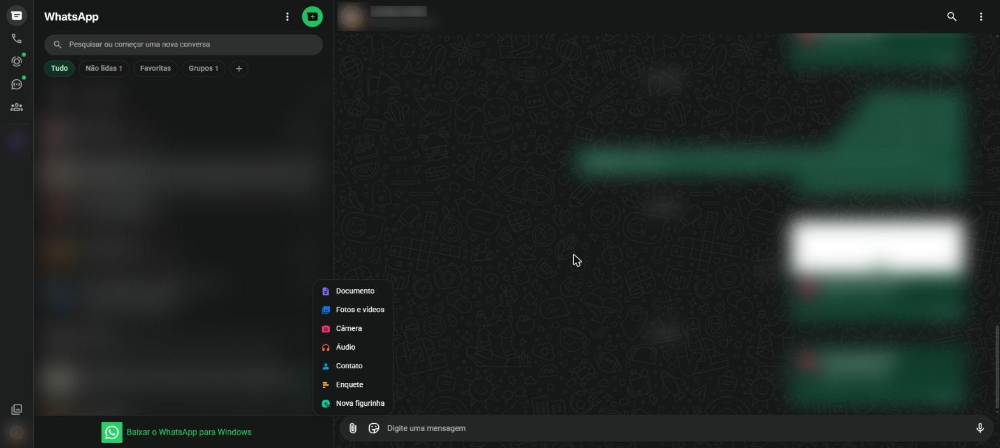

# Enviar arquivos e anexos {#sec-anexos}

O botão de clipe (**Anexar**), à esquerda do campo de mensagem, abre o menu de anexos (@fig-anexos). As opções podem variar um pouco entre conversas individuais e grupos.

{#fig-anexos}

| Opção | O que envia |
|---|---|
| **Documento** | Qualquer arquivo do computador: PDF, planilha, texto, apresentação. Até 2 GB |
| **Fotos e vídeos** | Imagens e vídeos guardados no computador |
| **Câmera** | Foto tirada na hora pela câmera do computador |
| **Áudio** | Arquivo de áudio guardado no computador, como uma música |
| **Contato** | O cartão de um contato da sua agenda |
| **Enquete** | Uma pergunta com opções de resposta para votação |
| **Evento** | Um convite com data, horário e local (disponível em grupos) |
| **Nova figurinha** | Cria uma figurinha a partir de uma imagem |

: Opções do menu de anexos {.striped}

## Enviar fotos e vídeos

1. Clique no clipe e escolha **Fotos e vídeos**.
2. Na janela do computador, selecione uma ou mais imagens e clique em **Abrir**.
3. Na prévia, é possível:
   - escrever uma **legenda** no campo de baixo;
   - recortar, girar, desenhar, escrever e colocar emojis sobre a imagem;
   - acrescentar outras imagens pelo botão **+**;
   - ativar a **visualização única**, para a foto sumir depois de aberta uma vez.
4. Clique no botão verde de envio.

::: {.callout-tip}
## Arrastar e soltar

No computador, também é possível arrastar uma foto ou um arquivo de uma pasta e soltar sobre a conversa aberta.
:::

## Enviar documentos

1. Clique no clipe e escolha **Documento**.
2. Selecione o arquivo e clique em **Abrir**.
3. Confira o nome do arquivo na prévia e clique em enviar.

Fotos enviadas como documento não perdem qualidade, porque o WhatsApp não as comprime.

## Enviar um contato

1. Clique no clipe e escolha **Contato**.
2. Marque um ou mais contatos da lista.
3. Clique em enviar. A outra pessoa recebe um cartão com o nome e o número, que pode salvar com um clique.

## Criar uma enquete

A enquete serve para decidir algo em grupo, como o dia de um encontro.

1. Clique no clipe e escolha **Enquete**.
2. Escreva a pergunta.
3. Escreva as opções de resposta, uma em cada campo.
4. Escolha se as pessoas poderão marcar mais de uma resposta.
5. Clique em enviar. Os votos aparecem na própria mensagem, atualizados na hora.

## Criar um evento

Disponível em grupos e comunidades.

1. Clique no clipe e escolha **Evento**.
2. Preencha o nome do evento, a descrição, a data, o horário e o local. Se quiser, marque a opção de link de ligação para um encontro on-line.
3. Clique em enviar. Os participantes respondem se vão ou não e recebem um lembrete perto da data.

## Compartilhar localização

A localização só pode ser enviada pelo celular.

1. No celular, abra a conversa e toque no clipe (Android) ou no **+** (iPhone).
2. Toque em **Localização**.
3. Escolha **Localização atual**, para enviar onde você está agora, ou **Localização em tempo real**, para que a pessoa acompanhe seus deslocamentos por um tempo escolhido (15 minutos, 1 hora ou 8 horas).

::: {.callout-warning}
## Localização é informação sensível

Compartilhe a localização apenas com pessoas de confiança. A localização em tempo real pode ser interrompida a qualquer momento em **Parar de compartilhar**.
:::
