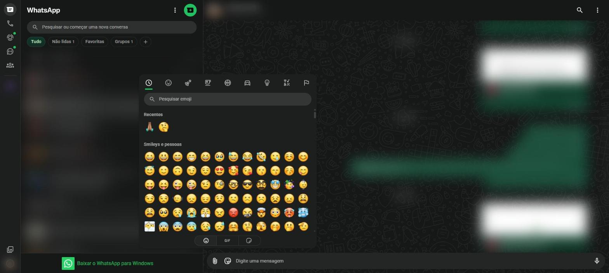
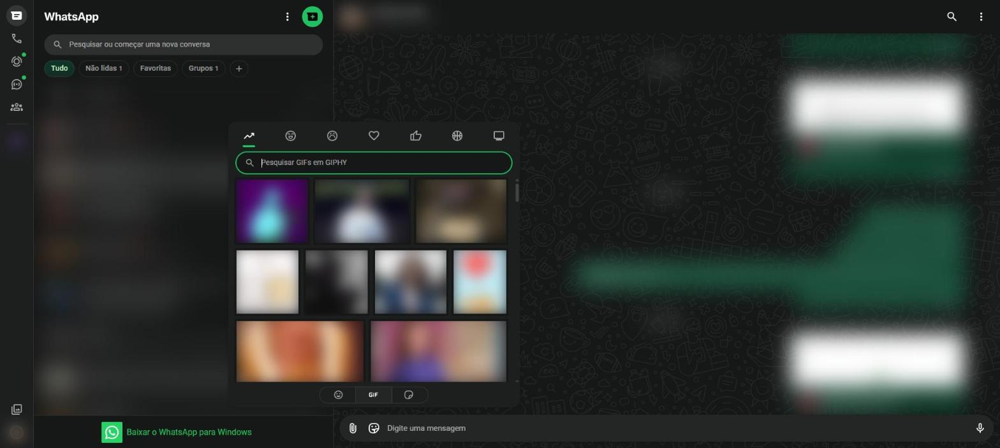
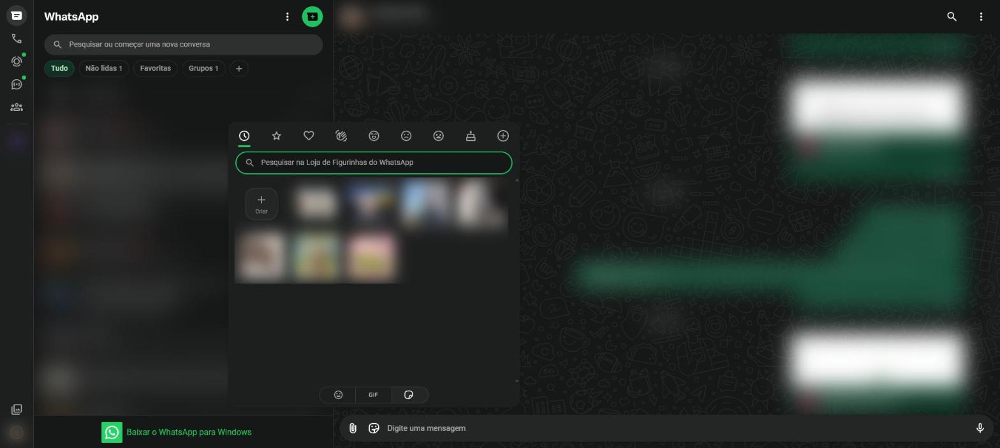

# Escrever e enviar mensagens {#sec-mensagens}

## Enviar uma mensagem de texto

1. Abra a conversa.
2. Clique no campo **Digite uma mensagem**, na parte de baixo da tela.
3. Escreva a mensagem.
4. Pressione <kbd>Enter</kbd> ou clique na seta verde de envio, que aparece no lugar do microfone.

Para pular uma linha sem enviar, use <kbd>Shift</kbd> + <kbd>Enter</kbd>.

## Os tiques da mensagem

Os tiques ao lado do horário mostram o que aconteceu com a mensagem enviada.

| Sinal | Significado |
|---|---|
| Relógio | A mensagem ainda está sendo enviada |
| Um tique cinza | Enviada, mas ainda não chegou ao aparelho da outra pessoa |
| Dois tiques cinza | Entregue no aparelho da outra pessoa |
| Dois tiques azuis | Lida pela outra pessoa |

: Tiques de confirmação {.striped}

Se a pessoa desligou as confirmações de leitura, os tiques ficam sempre cinza (@sec-privacidade).

## Formatar o texto

O WhatsApp permite destacar partes da mensagem com símbolos simples, colocados antes e depois do texto:

| Para obter | Escreva | Resultado |
|---|---|---|
| Negrito | `*texto*` | **texto** |
| Itálico | `_texto_` | *texto* |
| Tachado | `~texto~` | ~~texto~~ |
| Monoespaçado | ```` ```texto``` ```` | `texto` |
| Código em linha | `` `texto` `` | `texto` |
| Lista com marcadores | `- texto` ou `* texto` no começo da linha | lista |
| Lista numerada | `1. texto` no começo da linha | lista numerada |
| Citação | `> texto` no começo da linha | bloco de citação |

: Formatação de texto {.striped}

No computador também dá para selecionar o texto já digitado com o mouse: aparece uma pequena barra com as opções de formatação.

## Emojis

Emojis são pequenas figuras que expressam sentimentos e ideias, como uma carinha sorrindo ou um coração.

1. Clique no botão de carinha (**Emojis, GIFs, figurinhas**), à esquerda do campo de mensagem. Abre o painel da @fig-emojis.
2. Use as abas do alto para navegar pelas categorias (recentes, rostos, animais, comidas, atividades, viagens, objetos, símbolos e bandeiras) ou escreva no campo **Pesquisar emoji**, por exemplo `coração`.
3. Clique no emoji. Ele entra no campo de mensagem.
4. Envie com <kbd>Enter</kbd>.

{#fig-emojis}

Também é possível escrever `:` seguido do nome em inglês do emoji, como `:smile`, e escolher na lista que aparece.

## GIFs

GIFs são pequenas animações sem som, muito usadas para reagir com humor.

1. Abra o painel de emojis.
2. Clique na aba **GIF**, na parte de baixo do painel (@fig-gifs).
3. Escolha uma das categorias do alto ou pesquise no campo **Pesquisar GIFs em GIPHY**.
4. Clique no GIF. Ele abre em uma prévia, onde é possível escrever uma legenda.
5. Clique no botão de envio.

{#fig-gifs}

## Figurinhas

Figurinhas (*stickers*) são imagens maiores, muitas vezes com desenhos ou fotos recortadas.

1. Abra o painel de emojis.
2. Clique na aba de figurinhas, a última na parte de baixo do painel (@fig-figurinhas).
3. Navegue pelas figurinhas recentes, favoritas e pelos pacotes, ou pesquise na **Loja de Figurinhas do WhatsApp**.
4. Clique na figurinha para enviá-la na hora.

{#fig-figurinhas}

O botão **Criar** transforma uma imagem do computador em figurinha: escolha a imagem, recorte, acrescente textos ou emojis e envie.

## Mensagem de voz

Mensagens de voz (áudios) são úteis para quem tem dificuldade para digitar.

1. Clique no **microfone**, à direita do campo de mensagem. O navegador pode pedir permissão para usar o microfone; clique em **Permitir**.
2. Fale a mensagem. Um contador mostra o tempo de gravação.
3. Para enviar, clique na seta verde. Para pausar e ouvir antes, clique no botão de pausa. Para desistir, clique na lixeira.

No celular, segure o microfone enquanto fala e solte para enviar. Para não precisar segurar, arraste o dedo para cima até o cadeado: a gravação fica travada e você envia quando terminar.

::: {.callout-tip}
## Ouvir mais rápido

Ao ouvir um áudio recebido, clique em **1x** para trocar a velocidade para **1,5x** ou **2x**.
:::
