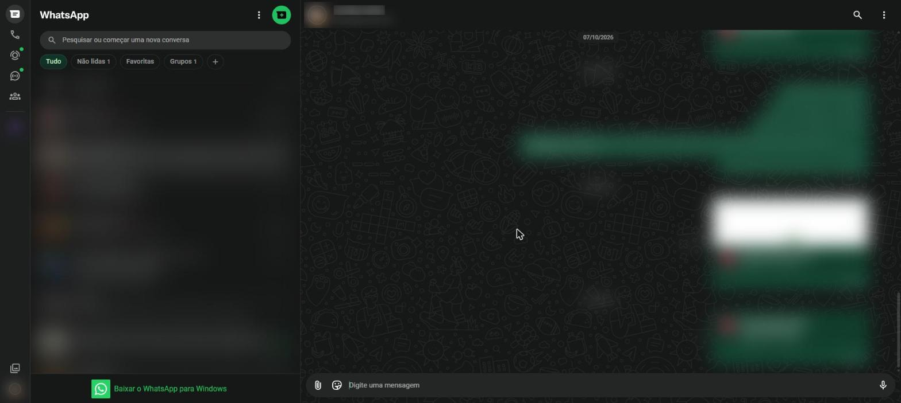
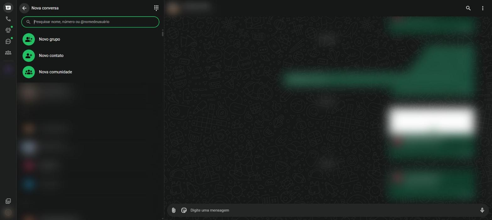

# Iniciar uma conversa {#sec-nova-conversa}

## Abrir uma conversa existente

Clique em qualquer conversa da lista. Ela abre na área da direita (@fig-conversa), com:

1. **Cabeçalho**, no alto, com a foto e o nome do contato ou do grupo. Clicar nele abre os dados do contato (@sec-opcoes-conversa);
2. **Mensagens**, no meio. As suas ficam à direita, em verde; as recebidas ficam à esquerda;
3. **Barra de digitação**, embaixo, com o clipe de anexos, o botão de emojis, o campo **Digite uma mensagem** e o microfone.

{#fig-conversa}

## Começar uma conversa nova

1. Clique no botão verde **Nova conversa**, acima da lista de conversas. Abre a tela da @fig-nova-conversa.
2. No campo **Pesquisar nome, número ou \@nomedeusuário**, escreva o nome do contato.
3. Clique no contato desejado. A conversa abre, pronta para receber a primeira mensagem.

{#fig-nova-conversa}

Nessa mesma tela ficam os atalhos:

- **Novo grupo**: cria um grupo (@sec-grupos);
- **Novo contato**: salva um número novo na sua conta;
- **Nova comunidade**: cria uma comunidade (@sec-comunidades).

O ícone de teclado numérico, no canto de cima, permite digitar um número de telefone diretamente, mesmo que ele não esteja salvo.

## Conversar consigo mesmo

O primeiro contato da lista é **você mesmo**, marcado como "(você)". Essa conversa funciona como um bloco de anotações: tudo o que você mandar ali fica guardado só para você. É útil para salvar lembretes, links e arquivos e para passar arquivos do celular para o computador.

## Adicionar um contato

1. Na tela **Nova conversa**, clique em **Novo contato**.
2. Preencha o nome, o sobrenome e o número com o código do país (no Brasil, `+55`) e o DDD.
3. Clique em **Salvar**. O contato passa a aparecer na lista.
