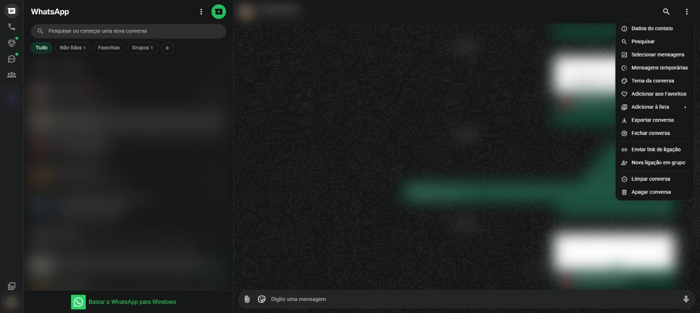
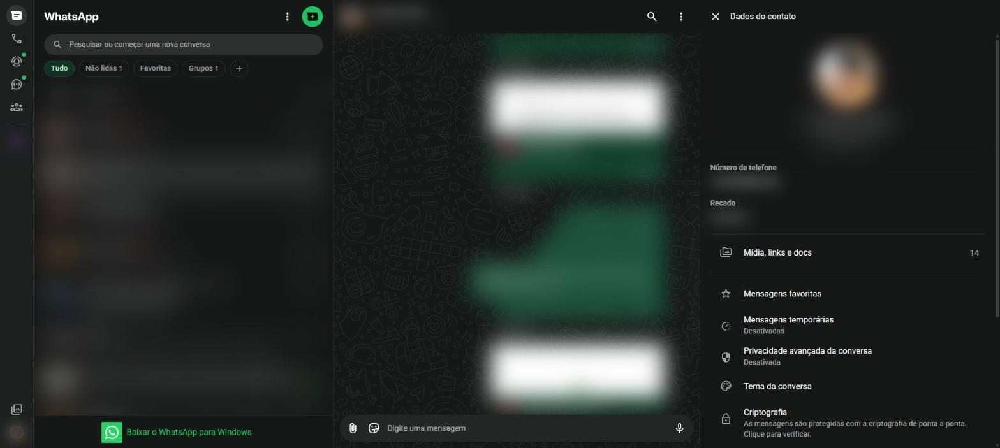
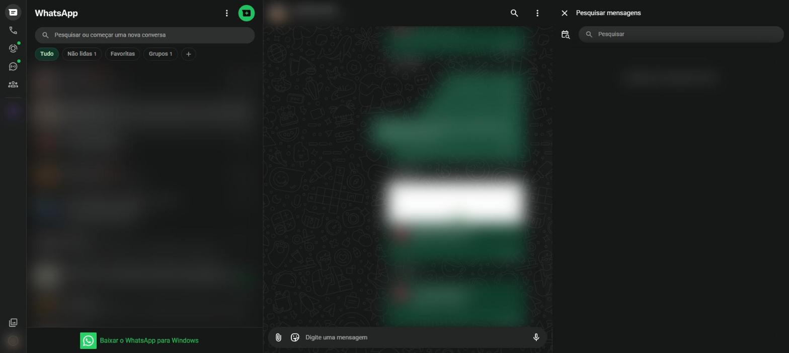
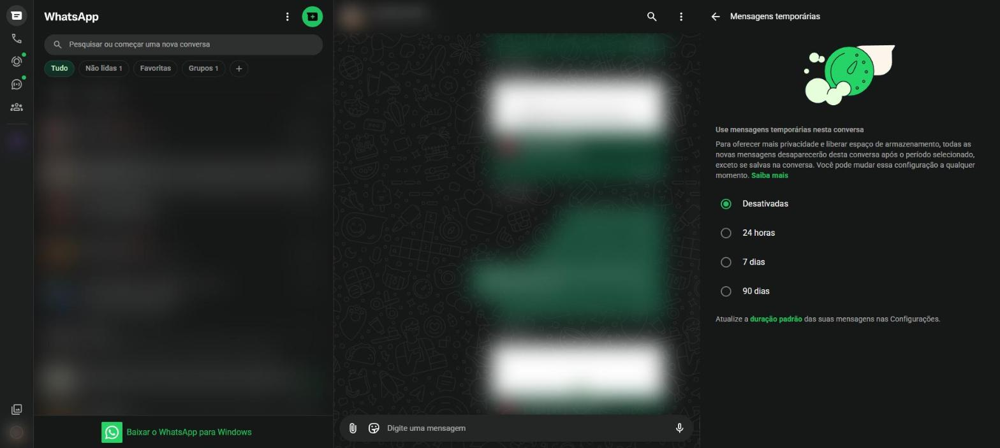

# Opções da conversa {#sec-opcoes-conversa}

No cabeçalho de toda conversa aberta há dois botões à direita: a lupa (**Pesquisar**) e os três pontinhos (**Mais opções**).

## Menu da conversa

Clique nos três pontinhos do cabeçalho para abrir o menu da @fig-menu-conversa.

{#fig-menu-conversa}

| Opção | O que faz |
|---|---|
| **Dados do contato** | Abre a ficha do contato ou do grupo |
| **Pesquisar** | Procura palavras dentro desta conversa |
| **Selecionar mensagens** | Marca várias mensagens para encaminhar, favoritar ou apagar |
| **Mensagens temporárias** | Faz as novas mensagens sumirem depois de um prazo |
| **Tema da conversa** | Muda as cores e o papel de parede só desta conversa |
| **Adicionar aos Favoritos** | Coloca a conversa no filtro **Favoritas** |
| **Adicionar à lista** | Coloca a conversa em uma lista personalizada |
| **Exportar conversa** | Salva o histórico da conversa em um arquivo |
| **Fechar conversa** | Fecha a conversa aberta (o mesmo que <kbd>Esc</kbd>) |
| **Enviar link de ligação** | Gera um link para uma ligação marcada |
| **Nova ligação em grupo** | Inicia uma chamada com várias pessoas |
| **Limpar conversa** | Apaga todas as mensagens, mas mantém a conversa na lista |
| **Apagar conversa** | Remove a conversa inteira da lista |

: Opções do menu da conversa {.striped}

## Dados do contato

Clique no nome do contato, no cabeçalho, ou em **Dados do contato** no menu. Abre um painel à direita (@fig-dados-contato) com:

- foto, nome e número de telefone;
- **Recado** da pessoa;
- **Mídia, links e docs**: tudo o que foi trocado na conversa, separado por tipo;
- **Mensagens favoritas** desta conversa;
- **Mensagens temporárias** e **Privacidade avançada da conversa**;
- **Tema da conversa** e **Criptografia**;
- no final, as opções de **Bloquear**, **Denunciar**, **Limpar conversa** e **Apagar conversa**.

{#fig-dados-contato}

Em um grupo, o mesmo painel mostra a descrição do grupo, a lista de participantes e as configurações do grupo (@sec-grupos).

## Pesquisar dentro da conversa

1. Clique na lupa do cabeçalho. Abre o painel **Pesquisar mensagens** (@fig-pesquisar-conversa).
2. Escreva a palavra procurada.
3. Clique em um resultado para ir direto à mensagem.

O ícone de calendário, à esquerda do campo, permite pular para uma data específica.

{#fig-pesquisar-conversa}

## Mensagens temporárias

Com as mensagens temporárias ligadas, as novas mensagens da conversa somem sozinhas depois do prazo escolhido.

1. Abra o menu da conversa e clique em **Mensagens temporárias** (@fig-mensagens-temporarias).
2. Escolha **24 horas**, **7 dias** ou **90 dias**. Para desligar, escolha **Desativadas**.

{#fig-mensagens-temporarias}

As mensagens que já estavam na conversa antes da mudança não são afetadas. Qualquer participante pode salvar uma mensagem específica para que ela não suma.

## Silenciar uma conversa

Silenciar faz a conversa parar de tocar o som de notificação, sem sair dela.

1. Na lista de conversas, passe o mouse sobre a conversa e clique na setinha que aparece.
2. Clique em **Silenciar notificações**.
3. Escolha por quanto tempo: **8 horas**, **1 semana** ou **Sempre**.

## Exportar conversa

A opção **Exportar conversa** gera um arquivo de texto com todo o histórico, que pode ser guardado como lembrança ou comprovante. No celular, é possível escolher se as fotos e os vídeos vão junto.
