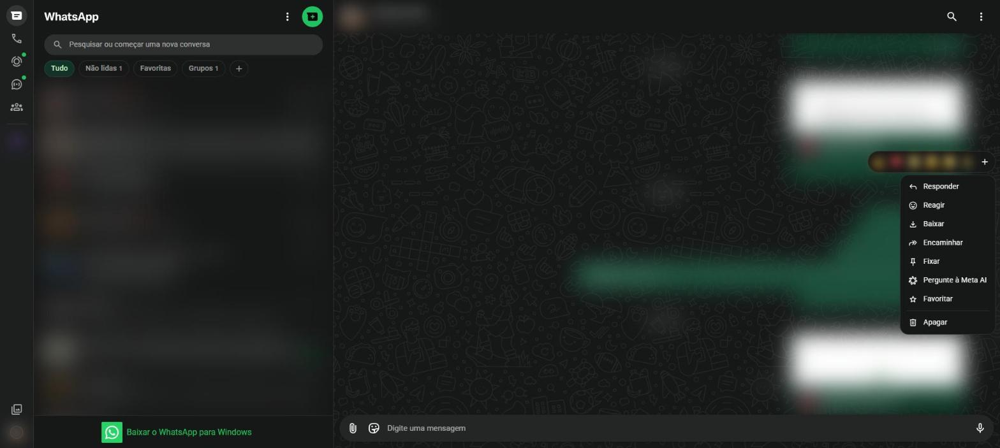

# Ações sobre uma mensagem {#sec-opcoes-mensagem}

Cada mensagem tem o seu próprio menu. Para abri-lo no computador:

1. Passe o mouse sobre a mensagem.
2. Clique na setinha que aparece no canto da mensagem (**Abrir opções de mensagem**).

Junto com o menu aparece uma barra de emojis para reagir (@fig-menu-mensagem). No celular, o mesmo menu aparece ao tocar e segurar a mensagem.

{#fig-menu-mensagem}

| Opção | O que faz |
|---|---|
| **Responder** | Cita a mensagem e escreve a resposta logo abaixo dela |
| **Reagir** | Coloca um emoji sobre a mensagem, sem escrever uma resposta |
| **Copiar** | Copia o texto da mensagem (aparece em mensagens de texto) |
| **Baixar** | Salva no computador a foto, o vídeo ou o documento |
| **Encaminhar** | Envia a mesma mensagem para outra conversa |
| **Fixar** | Prende a mensagem no alto da conversa |
| **Pergunte à Meta AI** | Pede à inteligência artificial uma explicação ou resumo |
| **Favoritar** | Marca a mensagem com uma estrela para achar depois |
| **Editar** | Corrige uma mensagem de texto já enviada (até 15 minutos depois) |
| **Apagar** | Remove a mensagem |

: Opções de uma mensagem {.striped}

## Responder a uma mensagem específica

1. Abra o menu da mensagem e clique em **Responder**.
2. A mensagem original aparece em destaque acima do campo de digitação.
3. Escreva a resposta e envie.

Em grupos, isso deixa claro a qual mensagem você está respondendo. No celular, basta arrastar a mensagem para a direita.

## Reagir

1. Passe o mouse sobre a mensagem e clique na carinha, ou abra o menu e clique em **Reagir**.
2. Escolha um dos emojis rápidos ou clique em **+** para ver todos.

Para retirar a reação, clique de novo no mesmo emoji.

## Encaminhar

1. Abra o menu da mensagem e clique em **Encaminhar**.
2. Marque uma ou mais conversas de destino.
3. Clique em enviar.

As mensagens encaminhadas aparecem com o aviso **Encaminhada**. Quando a mensagem já passou por muitas pessoas, aparece **Encaminhada com frequência** e só pode ser enviada para uma conversa por vez.

::: {.callout-warning}
## Antes de encaminhar

Mensagens encaminhadas com frequência são uma das principais formas de espalhar boatos e notícias falsas. Antes de repassar, confira a informação em fontes confiáveis.
:::

## Fixar

A mensagem fixada fica presa no alto da conversa, abaixo do cabeçalho, por 24 horas, 7 dias ou 30 dias. É útil para avisos importantes em grupos.

## Favoritar

Mensagens favoritadas ganham uma estrela e ficam reunidas em **Mensagens favoritas**, no menu principal (@fig-menu-principal) ou nos dados do contato.

## Editar

1. Abra o menu de uma mensagem de texto que você enviou há menos de 15 minutos.
2. Clique em **Editar**, corrija o texto e envie de novo.

A mensagem passa a mostrar o aviso **Editada**.

## Apagar

1. Abra o menu da mensagem e clique em **Apagar**.
2. Escolha:
   - **Apagar para mim**: some só da sua tela;
   - **Apagar para todos**: some para todos da conversa e fica o aviso "Mensagem apagada". Esta opção existe por cerca de 2 dias depois do envio.

## Selecionar várias mensagens

No menu da conversa, a opção **Selecionar mensagens** permite marcar várias mensagens para encaminhar, favoritar ou apagar todas de uma vez (@sec-opcoes-conversa).
