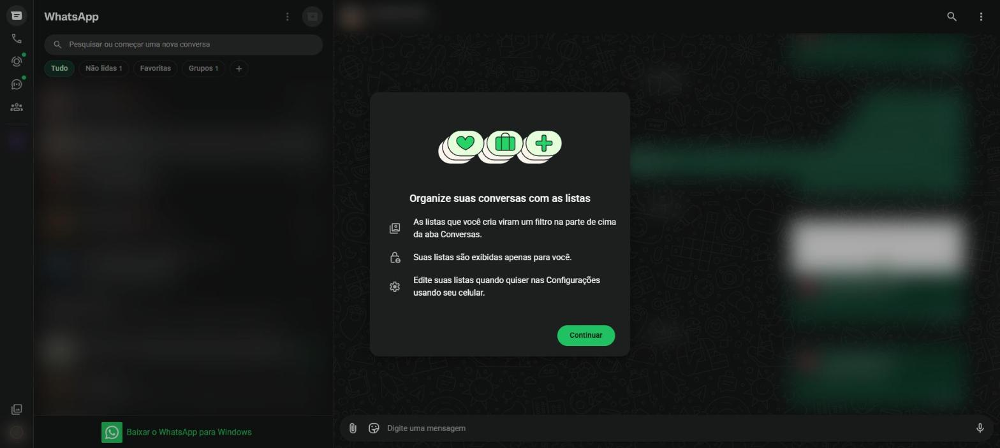
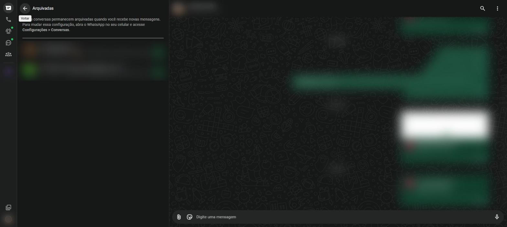

# Organizar as conversas {#sec-organizar}

Com o tempo, a lista de conversas fica longa. O WhatsApp oferece várias formas de deixá-la arrumada.

## Menu rápido de uma conversa

Na lista de conversas, passe o mouse sobre uma conversa e clique na setinha que aparece à direita. As opções são:

| Opção | O que faz |
|---|---|
| **Arquivar conversa** | Tira a conversa da lista principal e guarda em **Arquivadas** |
| **Silenciar notificações** | Para de tocar som para esta conversa |
| **Fixar conversa** | Prende a conversa no topo da lista (até 3 conversas) |
| **Marcar como não lida** | Volta a mostrar o círculo verde, como lembrete |
| **Adicionar aos Favoritos** | Coloca a conversa no filtro **Favoritas** |
| **Bloquear** | Impede que o contato envie mensagens e ligue para você |
| **Apagar conversa** | Remove a conversa da lista |

: Menu rápido de uma conversa {.striped}

## Filtros

Os botões acima da lista mostram só um tipo de conversa:

- **Tudo**: todas as conversas;
- **Não lidas**: só as que têm mensagens novas;
- **Favoritas**: só as conversas marcadas como favoritas;
- **Grupos**: só os grupos.

Clique de novo em **Tudo** para voltar à lista completa.

## Listas personalizadas

Além dos filtros prontos, é possível criar listas próprias, como "Família" ou "Trabalho".

1. Clique no **+** ao lado dos filtros. Na primeira vez, aparece a explicação da @fig-listas; clique em **Continuar**.
2. Dê um nome para a lista.
3. Clique em **Adicionar pessoas ou grupos** e marque as conversas.
4. Clique em **Criar lista**. Ela passa a aparecer como um novo filtro.

{#fig-listas}

## Conversas arquivadas

Arquivar esconde a conversa da lista principal sem apagar nada.

- **Para arquivar**: use o menu rápido da conversa e clique em **Arquivar conversa**.
- **Para ver as arquivadas**: clique em **Arquivadas**, no topo da lista de conversas (@fig-arquivadas).
- **Para desarquivar**: abra **Arquivadas**, use o menu rápido da conversa e clique em **Desarquivar conversa**.

{#fig-arquivadas}

Por padrão, as conversas arquivadas continuam arquivadas mesmo quando chegam mensagens novas. Essa regra pode ser trocada no celular, em **Configurações** > **Conversas** > **Manter conversas arquivadas**.

## Selecionar várias conversas

1. No menu principal (três pontinhos), clique em **Selecionar conversas**.
2. Marque as conversas desejadas.
3. Use os botões que aparecem no alto para arquivar, silenciar, marcar como lidas ou apagar todas juntas.
