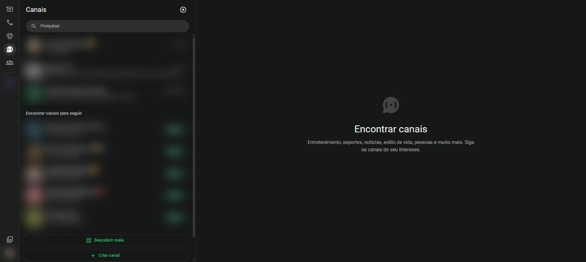

# Canais {#sec-canais}

Canais são perfis que publicam novidades para muitas pessoas ao mesmo tempo, como jornais, órgãos públicos, times, artistas e escolas. Diferente de um grupo, só o dono do canal publica; os seguidores leem e podem reagir com emojis.

Ninguém no canal vê o seu número de telefone, e o dono do canal não sabe quem você é.

Clique em **Canais**, na barra lateral, para abrir a seção da @fig-canais.

{#fig-canais}

## Encontrar e seguir um canal

1. Clique em **Canais**, na barra lateral.
2. Veja as sugestões em **Encontrar canais para seguir** ou clique em **Descobrir mais** para ver o diretório completo, separado por país e categoria.
3. Use o campo **Pesquisar** para procurar um canal pelo nome.
4. Clique em **Seguir** ao lado do canal.

## Deixar de seguir

1. Abra o canal.
2. Clique no nome do canal, no cabeçalho.
3. Clique em **Deixar de seguir**.

## Criar um canal

1. Clique em **Criar canal**, no final da lista, ou no **+** do alto.
2. Escreva o nome, a descrição e escolha uma imagem.
3. Clique em **Criar canal**. Agora você pode publicar textos, fotos, vídeos e enquetes para os seus seguidores.

::: {.callout-note}
## Canais oficiais

Muitos órgãos públicos têm canais oficiais com selo de verificação ao lado do nome. Prefira esses canais para se informar, em vez de mensagens encaminhadas sem origem.
:::
