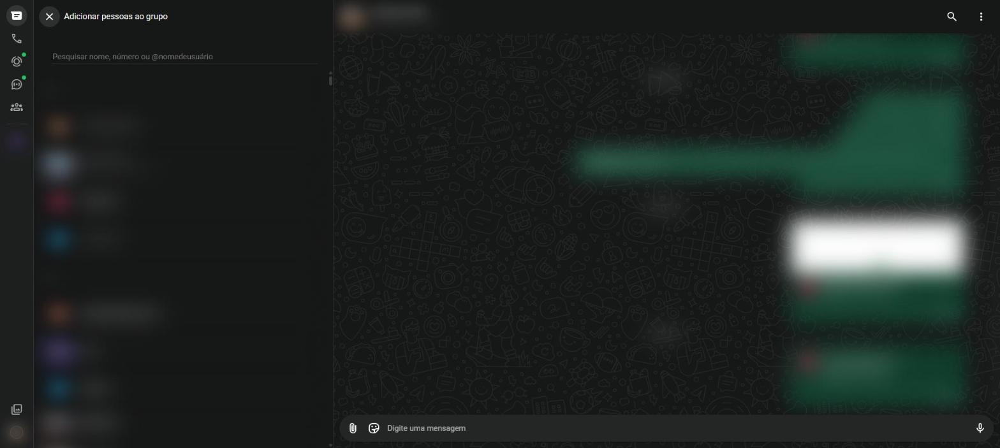

# Grupos {#sec-grupos}

Um grupo reúne várias pessoas na mesma conversa. Todos leem as mesmas mensagens e podem responder, o que facilita combinar encontros, avisar a família ou organizar uma turma. Um grupo pode ter até 1.024 participantes.

## Criar um grupo

1. Clique nos três pontinhos acima da lista de conversas e escolha **Novo grupo**. Também é possível usar **Nova conversa** > **Novo grupo**.
2. Na tela **Adicionar pessoas ao grupo** (@fig-novo-grupo), escreva o nome de cada pessoa no campo de pesquisa e clique para marcá-la. As pessoas escolhidas aparecem no alto.
3. Clique na seta verde, embaixo, para continuar.
4. Escreva o **nome do grupo** e, se quiser, escolha uma foto clicando no círculo de imagem.
5. Clique no botão verde de confirmação. O grupo é criado e aparece na lista de conversas.

{#fig-novo-grupo}

Quem cria o grupo se torna **administrador** (admin).

## Dados do grupo

Clique no nome do grupo, no cabeçalho da conversa, para abrir os dados do grupo. Ali é possível:

- trocar o nome, a foto e a **descrição** do grupo (se as permissões deixarem);
- ver a lista de **participantes**;
- **adicionar participantes** ou **convidar por link**;
- ver a mídia, os links e os documentos trocados;
- silenciar o grupo, ligar as mensagens temporárias e mudar o tema;
- **Sair do grupo** e **Denunciar grupo**, no final do painel.

## Funções do administrador

| Ação | Como fazer |
|---|---|
| Adicionar pessoas | Dados do grupo > **Adicionar participante** |
| Criar link de convite | Dados do grupo > **Convidar via link**; o link pode ser copiado, enviado ou redefinido |
| Remover alguém | Passe o mouse sobre o participante, clique na setinha e escolha **Remover** |
| Tornar alguém admin | No mesmo menu do participante, escolha **Promover a admin do grupo** |
| Aprovar novos membros | Configurações do grupo > **Aprovar novos participantes** |
| Limitar quem envia mensagens | Configurações do grupo > **Enviar mensagens** > **Apenas admins** |
| Limitar quem edita dados | Configurações do grupo > **Editar dados do grupo** > **Apenas admins** |

: Funções do administrador {.striped}

## Mencionar alguém

Em um grupo, escreva `@` seguido do nome do participante e escolha na lista. A pessoa recebe um aviso de que foi mencionada, mesmo com o grupo silenciado.

## Sair de um grupo

1. Abra os dados do grupo.
2. Role até o final e clique em **Sair do grupo**.
3. Confirme.

O grupo deixa de mandar mensagens para você. Para tirá-lo da lista, use em seguida **Apagar grupo**.

::: {.callout-tip}
## Quem pode colocar você em grupos

Para evitar ser incluído em grupos por desconhecidos, ajuste a opção **Grupos** na tela de privacidade (@sec-privacidade).
:::
