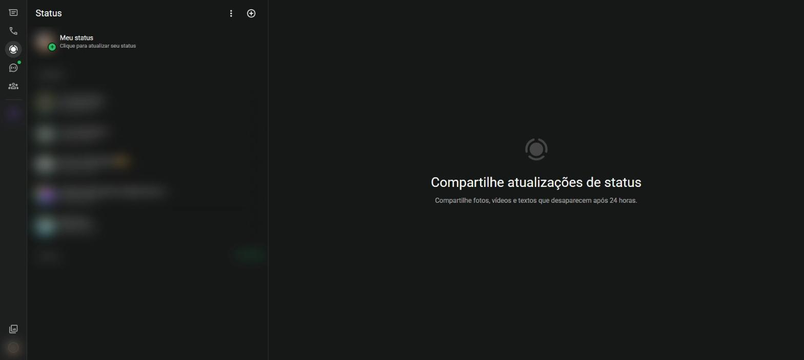
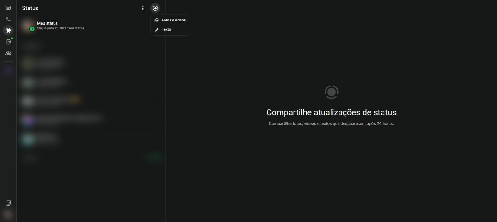
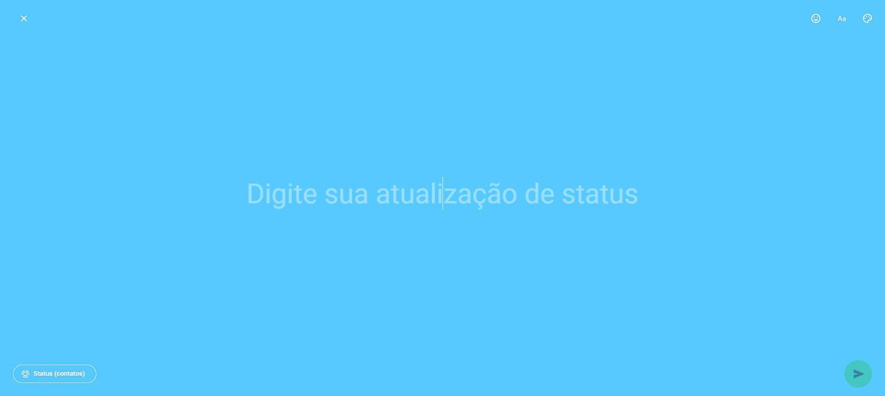

# Status {#sec-status}

O status é um espaço para compartilhar fotos, vídeos e textos que **desaparecem depois de 24 horas**. Ele não fica em nenhuma conversa: os seus contatos veem as publicações na seção **Status**.

Clique em **Status**, na barra lateral, para ver a tela da @fig-status. No alto fica **Meu status**; abaixo, as atualizações recentes dos seus contatos.

{#fig-status}

## Ver o status dos contatos

1. Clique em **Status**, na barra lateral.
2. Clique no nome de um contato. As publicações aparecem uma depois da outra.
3. Clique nas laterais da tela para avançar ou voltar. Pressione <kbd>Esc</kbd> para sair.

Um anel verde em volta da foto indica que há status ainda não visto.

Enquanto vê um status, é possível responder com uma mensagem, que chega na conversa com a pessoa, ou reagir com um emoji.

## Publicar um status de texto

1. Clique em **Status** e depois no **+**, no alto (@fig-status-adicionar).
2. Escolha **Texto**.
3. Escreva a mensagem (@fig-status-texto). Os botões do alto, à direita, permitem:
   - inserir emojis;
   - trocar a fonte das letras (**Aa**);
   - trocar a cor de fundo (paleta).
4. Clique no botão de envio, no canto de baixo.

{#fig-status-adicionar}

{#fig-status-texto}

Para desistir, clique no **X**, no canto de cima à esquerda; nada é publicado.

## Publicar uma foto ou vídeo

1. Clique em **Status** > **+** > **Fotos e vídeos**.
2. Escolha a imagem ou o vídeo no computador.
3. Escreva uma legenda, se quiser.
4. Clique em enviar.

## Quem vê o seu status

O botão no canto de baixo do editor (**Status (contatos)**) mostra para quem a publicação vai. As opções de privacidade do status são:

- **Meus contatos**: todos os contatos salvos;
- **Meus contatos, exceto...**: todos, menos as pessoas escolhidas;
- **Compartilhar somente com...**: apenas as pessoas escolhidas.

A mesma configuração fica em **Configurações** > **Privacidade** > **Status** (@sec-privacidade).

## Ver quem viu o seu status

Abra o seu próprio status e clique no ícone de olho, embaixo. A lista mostra quem viu cada publicação. Para apagar uma publicação antes das 24 horas, use o menu da publicação e escolha **Apagar**.
